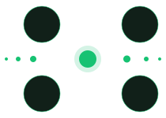

# Quant·ion



[](https://github.com/phenological/quantion/actions/workflows/test.yml)
[](https://crates.io/crates/quantion)
[](https://pypi.org/project/quantion/)
[](https://www.npmjs.com/package/quantion)
[](https://doi.org/10.5281/zenodo.22700673)

**Ionic Toolkit for LCMS data processing.**

A Rust core with bindings for R, Python and JavaScript.

<br clear="right">

## Install

```bash
cargo add quantion
```

## Quick start

Read an mzML file, calculate the EIC of a target and find its peak.

```rust
use quantion::{CalculateEicOptions, GetPeakOptions, calculate_eic, get_peak, parse_mzml};

let mut file = parse_mzml("sample.mzML")?;
let eic = calculate_eic(&mut file, 260.103, CalculateEicOptions { from: 2.0, to: 3.0, ..Default::default() })?;
let peak = get_peak(&eic, 2.383, GetPeakOptions { range: 0.05, ..Default::default() })?;
println!("rt {} intensity {}", peak.rt, peak.intensity);
```

## Other languages

- [R](wrappers/r/README.md)
- [Python](wrappers/python/README.md)
- [JavaScript](wrappers/js/README.md)

## Documentation

Every function, option and example: [API Documentation](https://phenological.github.io/quantion/)
